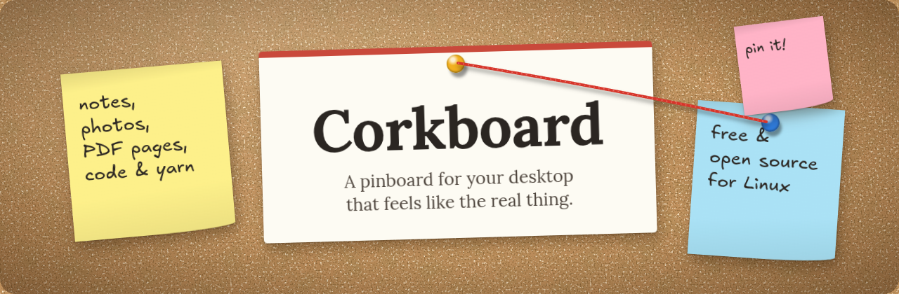
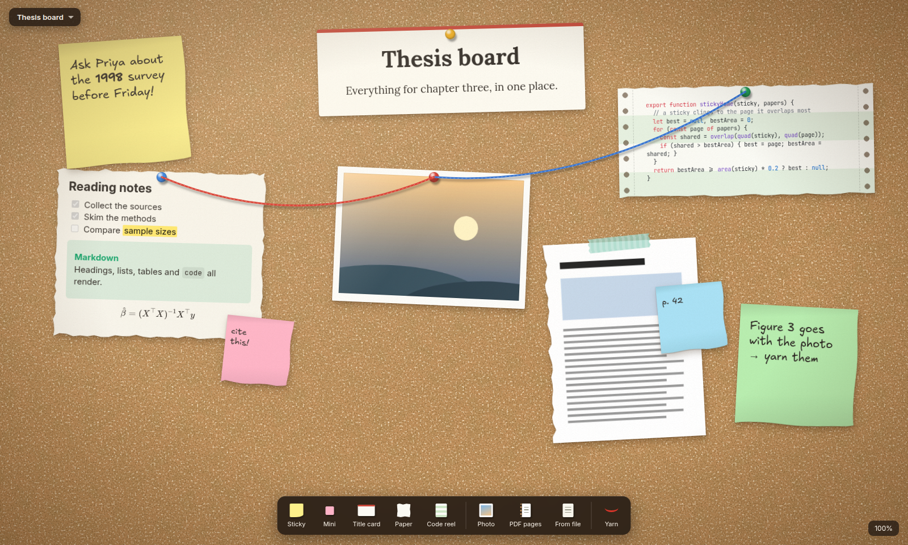

<p align="center"></p>

<p align="center">
  <a href="https://github.com/Kabramba/corkboard/releases/latest"></a>
  <a href="https://github.com/Kabramba/corkboard/actions/workflows/ci.yml"></a>
  <a href="LICENSE"></a>
  
</p>

**Corkboard** is an endless cork surface for your desktop. Stick notes on it, pin up photos, tear pages out of PDFs, hang a reel of code, and tie things together with yarn. Papers tilt, lift and sway when you move them, the way they would on a real board.

It is free, open source, works offline, and keeps your boards as plain folders on your own disk.

<p align="center"></p>

## Install

On Debian, Ubuntu and their relatives (64-bit Intel/AMD):

```bash
wget https://github.com/Kabramba/corkboard/releases/latest/download/corkboard_amd64.deb
sudo apt install ./corkboard_amd64.deb
```

Corkboard then appears in your applications menu. To remove it: `sudo apt remove corkboard` (your boards are left untouched).

You can also pick a specific version from the [Releases page](https://github.com/Kabramba/corkboard/releases).

## What you can put on a board

| | |
|---|---|
| **Sticky notes** | Two sizes, six colours, slightly wavy. They cling to the page they sit on and travel with it. |
| **Title cards** | Index cards with a coloured top edge. |
| **Paper scraps** | Torn-edge paper that renders Markdown the way Obsidian does: headings, lists, checkboxes, tables, callouts, `==highlights==`, `[[links]]`, code blocks. |
| **Equations** | LaTeX, inline with `$…$` and as blocks with `$$`. |
| **Photos** | Paste, drop or pick an image and it lands as a glossy print. |
| **PDF pages** | Drop a PDF, click the pages you want, and they are torn out onto the board. |
| **Code reels** | Tractor-feed paper with syntax highlighting. Drop any source file. |
| **Pins, tape and yarn** | Pin things up, tape papers together so they move as one, and run thread from pin to pin. |

Five typefaces are built in: Inter, Excalifont (hand), Lora (serif), Courier Prime (plain) and JetBrains Mono (code).

## Using it

| To do this | Do this |
|---|---|
| Move around | Drag the cork, or scroll |
| Zoom | Ctrl + scroll, or pinch |
| Add something | Use the dock at the bottom, paste (Ctrl+V), or drop files onto the board |
| Write | Double-click a paper |
| Move a paper | Drag it. Drag the corner handles to resize or rotate |
| Change a pin | Click to recolour, drag to move, right-click to pull it out |
| Tape | Drag the middle to move, drag an end to stretch and turn |
| Join two papers | Stretch a piece of tape from one onto the other |
| Yarn | Pick **Yarn**, then drag from one pin to another. Drag a thread up to tighten it, down to slacken it |
| Undo, duplicate, delete | Ctrl+Z, Ctrl+D, Delete |
| Switch boards | Click the board name in the top-left corner (Ctrl+O) |
| Settings | Ctrl+, |

## Your boards are just folders

Like an Obsidian vault, every board is an ordinary folder. New ones are created in `~/Corkboards`, and you can open a folder from anywhere, including a synced drive.

```
~/Corkboards/My Corkboard/
├── board.json        every note, position, pin and thread, as readable text
├── board.json.bak    a second copy of the latest save
├── assets/           your photos and PDF pages as .jpg files
└── backups/          timestamped snapshots
```

Corkboard is careful with this data:

- **Auto-save.** Every change is saved a moment later, and again when the window closes.
- **Crash-proof writes.** Each save goes to a temporary file and is swapped in only once complete.
- **Self-repair.** If `board.json` is ever unreadable, the board is restored from the `.bak` copy or the newest snapshot, and the damaged file is kept.
- **Snapshots.** One at every launch and at most every ten minutes while you work. The newest 60 are kept, plus one per day beyond that.

To back a board up or move it to another computer, copy its folder.

## Settings

- **Keep running in the system tray.** Closing the window unloads the board and leaves Corkboard waiting in the tray.
- **Start when I log in.**
- **Scroll wheel zooms** instead of moving the board.
- **Use less memory.** Draws without the graphics card: lighter, but less smooth.

Corkboard is built on Electron, so it is not tiny. Measured on Ubuntu 24.04: roughly 370 MB of memory with a board open (about 250 MB in the low-memory mode), roughly 340 MB while waiting in the tray, and no measurable CPU while idle.

## Build it yourself

You need [Node.js](https://nodejs.org) 22 or newer.

```bash
git clone https://github.com/Kabramba/corkboard.git
cd corkboard
npm install
npm start        # build and run
npm test         # unit tests, then an end-to-end run of the real app
npm run dist     # build release/corkboard_<version>_amd64.deb
```

## Contributing

Bug reports, ideas and pull requests are all welcome. [CONTRIBUTING.md](CONTRIBUTING.md) explains how the code is laid out and how to get a change merged. Forks are welcome too: the licence is MIT, so you can take Corkboard in your own direction.

## Built with

[Electron](https://www.electronjs.org), [Vite](https://vite.dev), [marked](https://marked.js.org), [KaTeX](https://katex.org), [highlight.js](https://highlightjs.org), [PDF.js](https://mozilla.github.io/pdf.js/) and [DOMPurify](https://github.com/cure53/DOMPurify). The hand font is [Excalifont](https://plus.excalidraw.com/excalifont) from the Excalidraw project; Inter, Lora, Courier Prime and JetBrains Mono come from [Fontsource](https://fontsource.org). All fonts are under the SIL Open Font License.

## Licence

[MIT](LICENSE) © Kabir Raval
